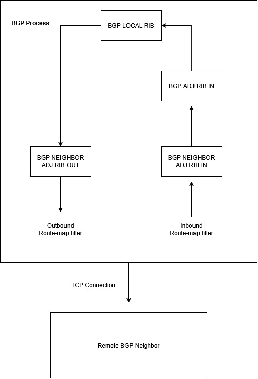
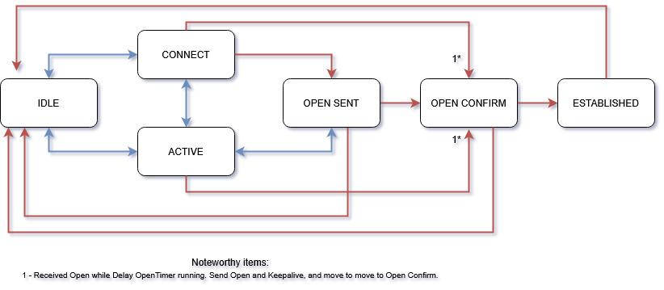

RustyBGP is my first attempt at a routing protocol written in, you guessed it, Rust.

This is currently **NOT** production ready.

**What is implemented:**

- Processing of the following BGP messages: Open, Keepalive, Updates
- Neighborship comes up
- Keeping the neighborship up
- Sending routes
- Receiving routes
- IPv4 Unicast Address Family
- Best path calculation
- Async via Tokio
- 2 byte and 4 byte ASN
- Resuming of neighbors after they go down
- Optional parameters for neighbors (capabilities like AS4, and other address families)
- Receiving and understanding (but not doing anything with) Notifications

**What's in progress:**

-  Console commands for displaying routes (in tui branch)
-  Route filtering (inbound and outbound)
-  GUI (in tui branch)

**What isn't implemented yet:**

-  Processing of BGP Notification
-  Handling of route refresh
-  Other address families (v6 or vpn)

**Terminal UI**

Route View

Log View

# Architecture Details

## Local RIB

In the below diagram I show how a route received from a BGP neighbor flows through the various RIBs in this program. 

Why have an ADJ RIB IN for both the neighbor and the BGP threads? 2 Reasons.

1. In the future, I will do the inbound and outbound route filtering at the neighbors. 
2. The routes in the BGP ADJ RIB IN are the ones that have been filtered but were not selected as the best paths. This allows me to clearly separate the best routes and be able to quickly promote or recover routes to prefixes. 

## BGP FSM

I created the below diagram based on what I read from BGP RFC 4271 because there were some, what I felt were, inconsistencies. The most notable one was skipping Open Sent and going directly to Open Confirm. I didn't see any diagrams that showed going from Active or Connect to Open Confirm. Granted, you have to send the Open and Keepalive, but you still don't really transition into the Open Sent state, you skip it and go directly to Open Confirm. At least, that's what I recall the RFC stating when I made the diagram several months ago.

